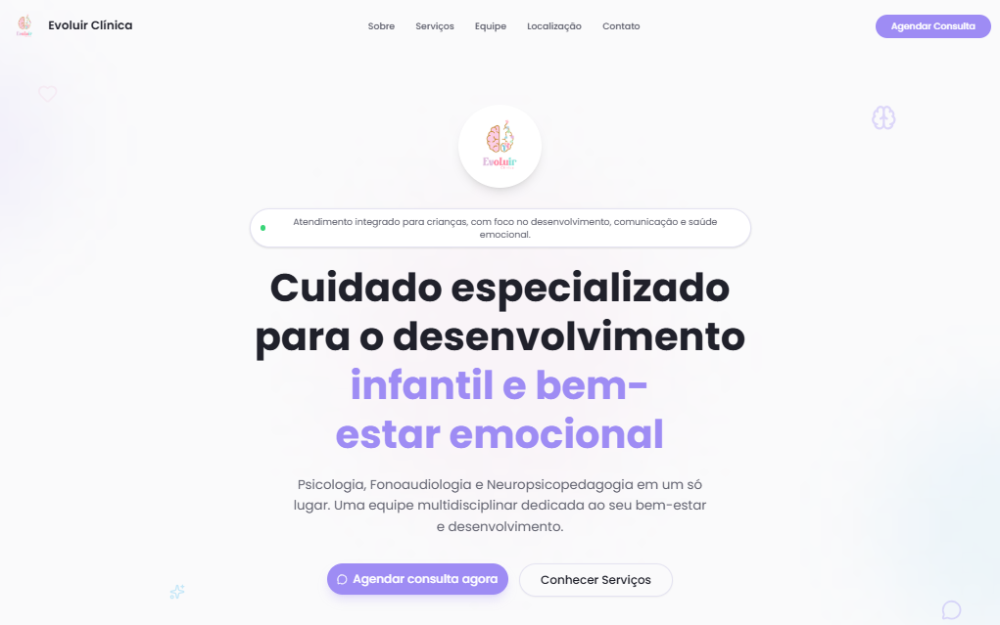

# Evoluir Clínica

Landing page institucional desenvolvida para a **Evoluir Clínica**, especializada em atendimento infantil nas áreas de Psicologia, Fonoaudiologia e Neuropsicopedagogia.

O projeto tem como objetivo apresentar os serviços, a equipe profissional e as informações de contato da clínica em uma interface responsiva e de fácil navegação.

> Projeto desenvolvido para uma clínica real, atualmente publicado e em utilização.

## Preview



## Demonstração

Acesse a versão online:

https://evoluir.convertstudio.com.br/

## Sobre o Projeto

A Evoluir Clínica oferece atendimento integrado voltado ao desenvolvimento infantil e ao bem-estar emocional.

A landing page foi desenvolvida para reunir as principais informações da clínica em um único ambiente, facilitando a apresentação dos serviços e o contato com os responsáveis pelos atendimentos.

O projeto foi originalmente construído com Next.js e TypeScript. Posteriormente, sua estrutura foi revisada e migrada para **React com JavaScript e Vite**, preservando a identidade visual e as funcionalidades da página.

A logo da clínica também passou por um processo de reconstrução vetorial no **Figma**, mantendo os elementos e as características da identidade visual original.

## Funcionalidades

- Apresentação institucional da clínica
- Exibição dos serviços e especialidades oferecidas
- Apresentação da equipe profissional
- Informações de localização e contato
- Botões de agendamento e integração com WhatsApp
- Navegação entre as seções da página
- Layout responsivo para diferentes tamanhos de tela

## Tecnologias Utilizadas

- **React:** construção da interface com componentes reutilizáveis
- **JavaScript:** desenvolvimento e organização dos componentes
- **HTML5 / JSX:** estruturação do conteúdo da página
- **CSS3:** estilização, layout e responsividade
- **Vite:** ambiente de desenvolvimento e compilação do projeto
- **Lucide React:** biblioteca de ícones utilizada na interface
- **Figma:** reconstrução e refinamento vetorial da logo
- **Vercel:** hospedagem e publicação da aplicação
- **Git e GitHub:** versionamento e gerenciamento do código

## Organização do Código

O projeto utiliza uma estrutura baseada em componentes React:

- `index.html` — documento HTML principal
- `src/main.jsx` — ponto de entrada da aplicação React
- `src/App.jsx` — composição das seções da página
- `src/components/` — componentes responsáveis pelas diferentes seções da landing page
- `src/data/site.js` — dados e informações utilizados na interface
- `src/index.css` e `src/App.css` — estilos visuais e responsividade
- `public/` — imagens, logo e demais recursos estáticos
- `vite.config.js` — configuração do Vite

## Como Executar Localmente

Clone o repositório:

```bash
git clone https://github.com/Phel-lip/clinica-landing-template.git
```

Acesse a pasta do projeto:

```bash
cd clinica-landing-template
```

Instale as dependências:

```bash
npm install
```

Inicie o servidor de desenvolvimento:

```bash
npm run dev
```

Para gerar a versão de produção:

```bash
npm run build
```

## Objetivo e Aprendizados

O principal objetivo do projeto foi desenvolver uma interface institucional para uma clínica real, priorizando organização das informações, responsividade e facilidade de contato.

A atualização posterior permitiu trabalhar com a organização de componentes em React, simplificação da estrutura do código e migração de tecnologias em uma aplicação existente.

O projeto também proporcionou experiência com versionamento por branches no Git, configuração de deploy na Vercel e reconstrução de elementos visuais no Figma.

## Autor

**Thasso Holanda**

GitHub: https://github.com/Phel-lip
